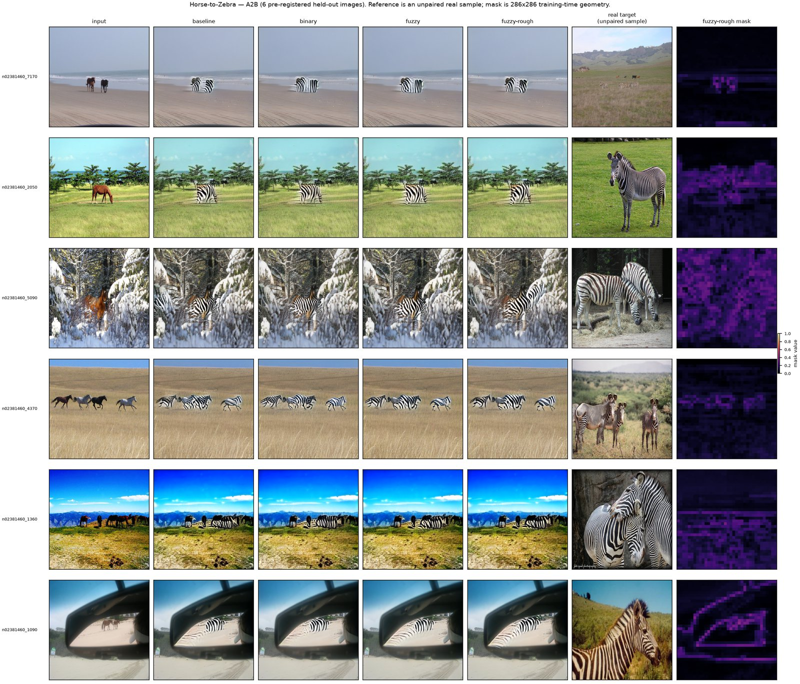
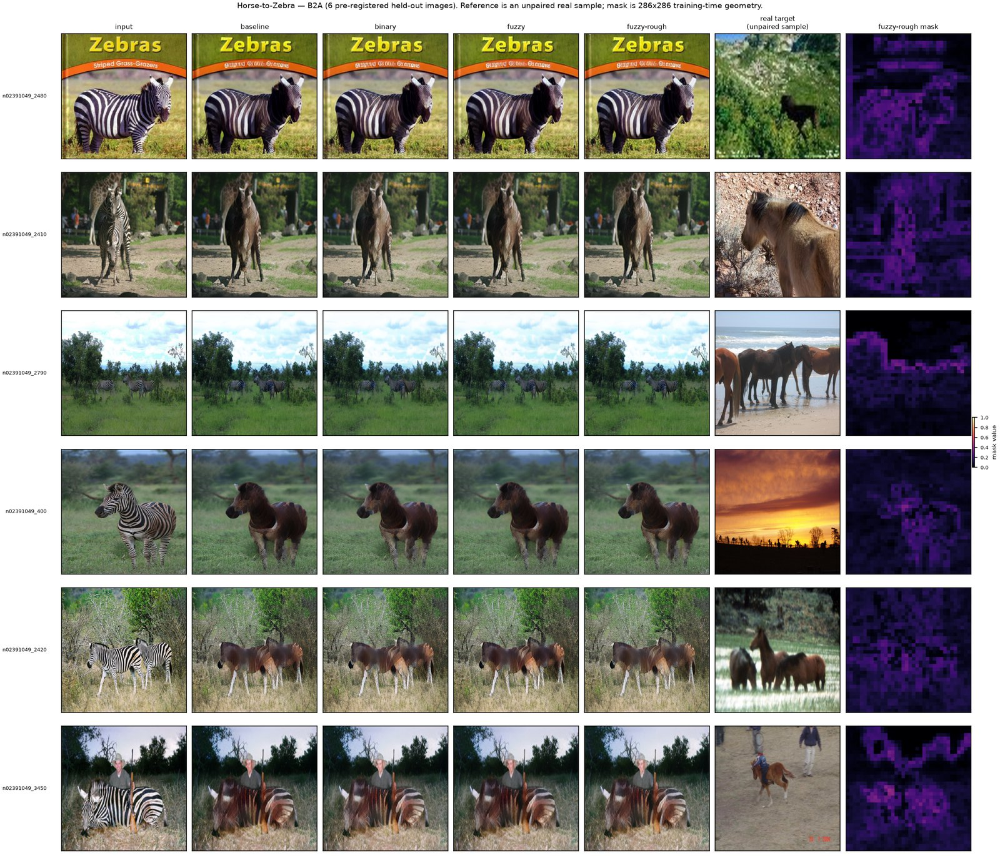
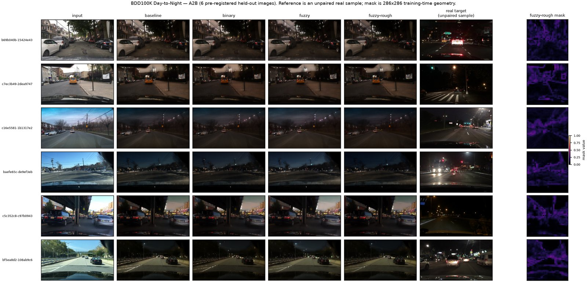
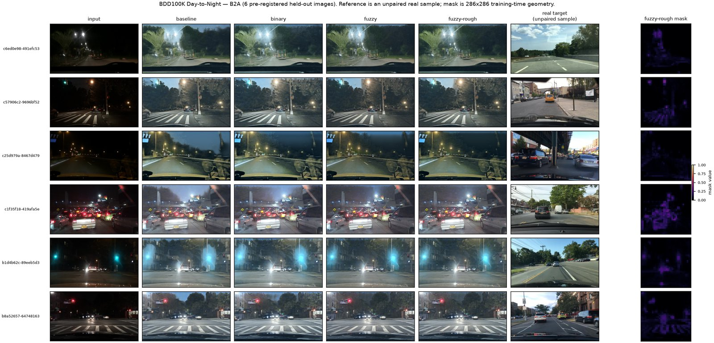
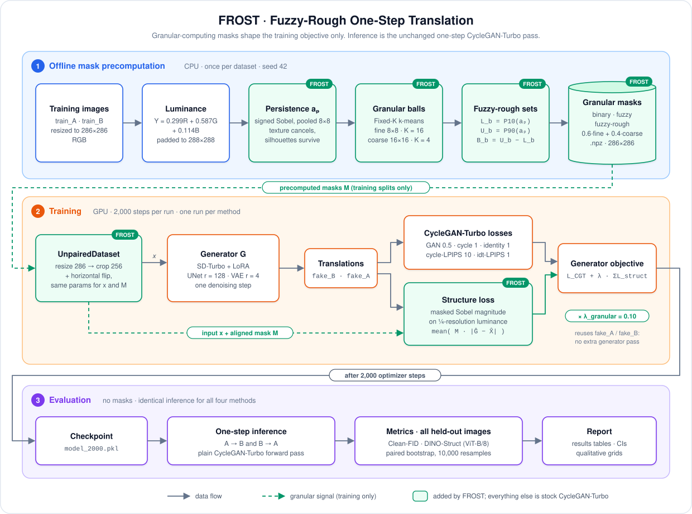

<div align="center">

# FROST: Fuzzy-Rough One-Step Translation

**Granular-computing structure masks that guide one-step diffusion image translation during training.**

[](https://www.python.org/)
[](https://pytorch.org/)
[](https://developer.nvidia.com/cuda-toolkit)
[](https://github.com/huggingface/diffusers)
[](https://github.com/GaParmar/img2img-turbo)
[](tests/)
[](LICENSE)

[Overview](#overview) •
[Results](#key-results) •
[Architecture](#architecture) •
[Method](#method) •
[Getting started](#getting-started) •
[Configuration](#configuration) •
[Citation](#citation)

</div>

---

## Overview

One-step diffusion translators such as [CycleGAN-Turbo](https://github.com/GaParmar/img2img-turbo) change the appearance of an image (horse → zebra, day → night) in a single denoising step. They are fast, but they can blur or move object boundaries along the way. FROST asks a focused question:

> **Can a lightweight granular-computing signal improve the trade-off between structure and appearance in one-step unpaired image translation, without adding an extra inference pass?**

FROST builds a **structure-confidence mask** for every training image using **granular balls**: clusters of image patches at two scales. Each ball is summarised by fuzzy memberships and by **fuzzy-rough lower and upper approximations**. The mask then weights a cheap edge-based **structure-preservation loss** that is added to the standard CycleGAN-Turbo objective.

Highlights:

- **Training-only signal.** Masks and the structure loss are used only during training. Inference is the unchanged one-step CycleGAN-Turbo forward pass.
- **Three granular mask families** are compared against a baseline under one controlled protocol: binary, fuzzy and fuzzy-rough.
- **Two datasets, both directions:** Horse ↔ Zebra and a deterministic BDD100K Day ↔ Night subset, giving 2 datasets × 4 methods × 2 directions = **16 evaluated entries**.

---

## Key results

All numbers come from the final checkpoint (`model_2000.pkl`), evaluated on **every held-out image**. For both metrics, **lower is better**. The best value in each column is in **bold**.

### Horse ↔ Zebra

| Method | FID A→B | FID B→A | DINO-Struct A→B | DINO-Struct B→A |
|---|---:|---:|---:|---:|
| Baseline | 56.05 | 163.34 | **0.0186** | 0.0170 |
| Binary granular | 49.91 | 166.00 | 0.0200 | **0.0166** |
| Fuzzy granular | **49.75** | **160.26** | 0.0201 | 0.0176 |
| Fuzzy-rough granular | 51.53 | 163.61 | 0.0207 | 0.0169 |

### BDD100K Day ↔ Night

| Method | FID A→B | FID B→A | DINO-Struct A→B | DINO-Struct B→A |
|---|---:|---:|---:|---:|
| Baseline | 100.74 | 125.49 | **0.0180** | 0.0322 |
| Binary granular | 96.50 | 127.36 | 0.0219 | 0.0288 |
| Fuzzy granular | **91.07** | **124.19** | 0.0193 | 0.0247 |
| Fuzzy-rough granular | 100.90 | 126.09 | 0.0191 | **0.0238** |

A = horse / daytime, B = zebra / nighttime.

### What the results show

1. **The fuzzy mask gives the lowest FID in all four dataset-direction pairs.** The largest gains are in the A→B direction: Horse→Zebra FID drops from 56.05 to 49.75 (−11.2 %) and Day→Night from 100.74 to 91.07 (−9.6 %).
2. **Structure (DINO-Struct) is mostly a trade-off, not a win.** In the A→B direction, every granular variant is slightly worse than the baseline on both datasets. In Night→Day, however, all three variants improve on the baseline, and fuzzy-rough improves the most (0.0322 → 0.0238, −26 %).
3. **Only one entry is "better overall"**: BDD fuzzy in the B→A direction, where both metrics fall. Across the 12 method-direction comparisons against the baseline, the verdicts are **6 distribution trade-offs** (FID down, DINO-Struct up), **4 structure trade-offs** (DINO-Struct down, FID up), **1 better overall** and **1 worse overall** (BDD fuzzy-rough, Day→Night, where both metrics rise slightly). The main outcome is therefore a distribution trade-off, not a clean improvement.
4. **Uncertainty.** Paired bootstrap tests on per-image DINO-Struct (10,000 resamples) give 95 % intervals that exclude zero for 11 of the 12 comparisons. These intervals capture image-sampling variability within a **single seed**. They do not show that the methods differ significantly across seeds.

### Qualitative comparison

Each grid has six pre-registered held-out images, one per row. The seven columns are: input · baseline · binary · fuzzy · fuzzy-rough · real target · fuzzy-rough mask. The images were chosen by hash in [`qualitative_selection.json`](report/tables/qualitative_selection.json) before any output was viewed. The grids below are compressed previews; click one to open the full-resolution PNG.

| Horse → Zebra | Zebra → Horse |
|:---:|:---:|
| [](report/figures/qual_horse_a2b.png) | [](report/figures/qual_horse_b2a.png) |
| **Day → Night** | **Night → Day** |
| [](report/figures/qual_bdd_a2b.png) | [](report/figures/qual_bdd_b2a.png) |

---

## Method

### Architecture

<p align="center">
  
</p>

FROST has three stages:

1. **Offline mask precomputation (CPU, once per dataset).** Every training image is turned into a structure-confidence mask through gradient persistence, two-scale granular balls and fuzzy-rough approximations. Masks are written once as `.npz` files.
2. **Training (GPU).** The dataset loader applies the *same* random crop and flip to an image and its mask. The structure loss compares the input with the translation the generator already produced and is added to the CycleGAN-Turbo objective with weight λ = 0.10.
3. **Evaluation.** The final checkpoint is run with the plain one-step forward pass. No masks are loaded and no extra pass is added, so inference cost is identical for all four methods.

### 1. Signed-gradient persistence

Each training image is converted to luminance, and Sobel derivatives are computed at full resolution. The derivatives are also average-pooled **with their signs kept** over 8×8 windows. Keeping the signs lets the opposing gradients of repetitive texture, such as zebra stripes or foliage, cancel out, while stable silhouettes survive pooling. For each patch *p*:

```text
persistence_p   = clip(4.0 · g8_p / (g1_p + ε), 0, 1)
edge_strength_p = g1_p / (max(g1) + ε)
a_p             = clip(persistence_p · sqrt(edge_strength_p), 0, 1)
```

### 2. Granular balls and fuzzy-rough approximations

Patches are described by `[mean_Y, std_Y, a_p, 0.5·x, 0.5·y]`, standardised per image, and grouped by a deterministic Fixed-K k-means at two scales: fine (8×8 patches, K = 16) and coarse (16×16 patches, K = 4). For every ball *b*:

| Quantity | Definition | Meaning |
|---|---|---|
| `L_b` | 10th percentile of `a_p` in the ball | robust lower approximation |
| `U_b` | 90th percentile of `a_p` in the ball | robust upper approximation |
| `B_b` | `U_b − L_b` | boundary width (ambiguity) |
| `mean_b` | mean of `a_p` in the ball | ball-level fuzzy structure |

### 3. Mask families

| Mask | Definition | Intuition |
|---|---|---|
| **Binary** | `1 if mean_b ≥ median(mean_b) else 0` | protect the more structured half of the balls |
| **Fuzzy** | `clip(0.5·a_p + 0.5·mean_b, 0, 1)` | graded confidence that mixes patch and ball evidence |
| **Fuzzy-rough** | `clip(a_p · L_b / (U_b + ε) − 0.25·B_b, 0, 1)` | most selective: penalises ambiguous boundary balls |

### 4. Structure-preservation loss

The input and the translated output are converted to luminance and average-pooled by 4. On these maps, the Sobel magnitude of each is normalised by its own spatial mean, which makes the comparison robust to global illumination changes such as day → night:

```text
L_struct(x, G(x), M) = mean( M_4 · | Mag_hat(Y_G(x)) − Mag_hat(Y_x) | )

L_generator = L_CycleGAN-Turbo + λ_granular · (L_struct,A→B + L_struct,B→A),   λ_granular = 0.10
```


### Compared conditions

| Condition | `granular_mode` | `lambda_granular` |
|---|---|---:|
| Baseline | `none` | 0 |
| Binary granular | `binary` | 0.10 |
| Fuzzy granular | `fuzzy` | 0.10 |
| Fuzzy-rough granular | `fuzzy_rough` | 0.10 |

Everything else is held constant across all eight runs: SD-Turbo checkpoint, LoRA ranks, data splits, preprocessing, optimisation budget, seed, attention implementation and precision.

---

## Getting started

### Requirements

| Component | Version used |
|---|---|
| Python | 3.11 |
| PyTorch / torchvision | 2.10.0 / 0.25.0 (CUDA 12.8 build) |
| Diffusers · Transformers · PEFT · Accelerate | 0.42.0 · 5.17.0 · 0.21.0 · 1.15.0 |
| GPU | one CUDA GPU per job |
| OS | Linux (the launchers use `bash` and `tmux`) |
| Hardware used for the reported runs | 2× NVIDIA RTX 5090 (32 GB) |

All runs use PyTorch's native scaled-dot-product attention (SDPA).

### Installation

```bash
git clone https://github.com/codewith-rafi/FROST.git frost
cd frost

conda create -n frost python=3.11 -y
conda activate frost

# 1. Install the PyTorch build that matches your CUDA driver, e.g.:
pip install torch==2.10.0 torchvision==0.25.0 --index-url https://download.pytorch.org/whl/cu128

# 2. Install the remaining dependencies
pip install -r requirements.txt
```

The project code lives in `src/frost/`, and the CycleGAN-Turbo backbone is vendored under `vendor/img2img-turbo/src/`. Both must be on `PYTHONPATH`:

```bash
export PYTHONPATH="$PWD/src:$PWD/vendor/img2img-turbo/src${PYTHONPATH:+:$PYTHONPATH}"
```

Optional pre-caching of the evaluation weights is useful on slow or offline networks:

```bash
bash scripts/precache_cleanfid_inception.sh   # Clean-FID Inception (size-verified)
bash scripts/precache_lpips_vgg.sh            # VGG16 weights for LPIPS
```

### Running on your own machine

The launchers run inside whatever Python environment is active and can be adjusted with environment variables. The defaults work on a single-GPU machine:

| Variable | Default | Used by |
|---|---|---|
| `PYTHON` | `python` on your `PATH` | all launchers |
| `ACCEL` | `accelerate` next to `PYTHON` | `launch_train.sh` |
| `CUDA_VISIBLE_DEVICES` | `0` | training and evaluation launchers |
| `HF_ENDPOINT` | unset (official Hugging Face Hub) | training and evaluation launchers |
| `FRESH_DATE` / `FRESH_ROOT` | today / `output/fresh_<FRESH_DATE>` | training launchers |
| `HORSE_RUNS` / `BDD_RUNS` | the archived run folders | `run_course_eval.sh` |


### Datasets

Datasets are **not** included in the repository (`data/` is git-ignored). [`data/readme.md`](data/readme.md) gives the exact expected layout, prompt files and mask format.

| Dataset | train_A | train_B | test_A | test_B | Source |
|---|---:|---:|---:|---:|---|
| `horse2zebra` | 1,067 | 1,334 | 120 | 140 | full standard CycleGAN split |
| `bdd100k_day_night` | 1,067 | 1,334 | 120 | 140 | deterministic BDD100K subset (seed 37) |


### 1. Precompute masks and train

The binary, fuzzy and fuzzy-rough runs need precomputed masks first:

```bash
bash scripts/precompute_masks.sh horse2zebra
bash scripts/precompute_masks.sh bdd100k_day_night
```

```bash
# one run
bash scripts/launch_train.sh configs/course/horse2zebra_fuzzy_rough.yaml

# all eight runs sequentially (Horse ×4, then BDD ×4), all in one output/fresh_<date>/ folder
bash scripts/run_course_primary.sh

# BDD only; skips runs that already have a complete model_2000.pkl
bash scripts/run_course_bdd.sh
```

### 2. Evaluate

```bash
# one checkpoint: Clean-FID + DINO-Struct on all held-out images, both directions.
# Pass the run's own config.yaml, not the one in configs/course/.
RUN=output/fresh_YYYYMMDD/horse2zebra/fuzzy_rough
bash scripts/eval_checkpoint.sh $RUN/config.yaml $RUN/checkpoints/model_2000.pkl

# all eight runs sequentially (skips runs that already have a valid metrics.json)
HORSE_RUNS=output/fresh_YYYYMMDD/horse2zebra \
BDD_RUNS=output/fresh_YYYYMMDD/bdd100k_day_night \
  bash scripts/run_course_eval.sh
```

### 3. Single-image inference

```bash
python vendor/img2img-turbo/src/inference_unpaired.py \
  --model_path output/.../checkpoints/model_2000.pkl \
  --input_image data/horse2zebra/test_A/n02381460_20.jpg \
  --prompt "a zebra" --direction a2b \
  --output_dir outputs/demo --image_prep no_resize
```

### 4. Run the tests

```bash
pytest tests/ -q
```

The suite covers the CLI arguments, image/mask alignment in the dataset, the mask builder, the structure loss and the deterministic BDD100K subset (seed 37).

---

## Configuration

Each run has one YAML file in [`configs/course/`](configs/course/), named `<dataset>_<method>.yaml`. The method-specific keys are:

```yaml
dataset: horse2zebra
method: fuzzy_rough
dataset_folder: data/horse2zebra
granular_mask_dir: data/horse2zebra/masks
granular_mode: fuzzy_rough        # none | binary | fuzzy | fuzzy_rough
lambda_granular: 0.1              # 0 for the baseline
```

Shared training settings:

| Setting | Value | Setting | Value |
|---|---|---|---|
| Backbone | `stabilityai/sd-turbo`, 1 step | Training iterations | 2,000 (each: 3 generator + 2 discriminator updates) |
| LoRA rank (UNet / VAE) | 128 / 4 | Checkpoint interval | 500 |
| Learning rate | 1e-5, constant | Batch size / accumulation | 1 / 1 |
| Precision | FP32 weights + TF32 matmul and cuDNN | Attention | native SDPA |
| λ GAN / idt / cycle | 0.5 / 1 / 1 | λ cycle-LPIPS / idt-LPIPS | 10 / 1 |
| Seed (training and masks) | 42 | DataLoader workers | 8 (Horse), 0 (BDD) |

`horse2zebra_util_gate_100.yaml` is the short benchmark configuration used to measure throughput before the main runs.

---

## Supporting diagnostics

- **Total compute**:

  | Phase | Wall time | GPU time |
  |---|---:|---:|
  | Training, 8 runs (one GPU per run) | 77 h 21 min 55 s | ≈ 77.37 GPU-hours |
  | Evaluation, 8 runs | 25 h 56 min | ≈ 25.93 GPU-hours |
  | **Total** | | **≈ 103.3 GPU-hours** |


---

## Acknowledgements

- **CycleGAN-Turbo / img2img-turbo**: G. Parmar, T. Park, S. Narasimhan and J.-Y. Zhu, *One-Step Image Translation with Text-to-Image Models*, arXiv:2403.12036 (2024). The backbone is vendored under its MIT license; see [`vendor/img2img-turbo/LICENSE`](vendor/img2img-turbo/LICENSE).
- **SD-Turbo** by Stability AI, **Clean-FID** for FID computation, and **DINO** (ViT-B/8) for the DINO-Struct metric.
- **Datasets:** the CycleGAN Horse ↔ Zebra dataset and [BDD100K](https://www.vis.xyz/bdd100k/). Both are distributed under their own licenses and are not redistributed here.

---

## Team

FROST was developed as a course project in Granular Computing.

- **Project Leader:** Rafi Ahmed
- **Team Member:** Ridoy Kumar Adhikary
- **Team Member:** Iftekhar Alam Fahim

---

## Citation

If you use this code or build on these results, please cite:

```bibtex
@misc{frost2026,
  title  = {{FROST}: Fuzzy-Rough One-Step Translation},
  author = {Rafi Ahmed and Ridoy Kumar Adhikary and Iftekhar Alam Fahim},
  year   = {2026},
  url    = {https://github.com/codewith-rafi/FROST},
  note   = {Course project, Granular Computing}
}
```

---

## License

Released under the [MIT License](LICENSE). The vendored code in `vendor/img2img-turbo/` keeps its original MIT license and copyright notice.
